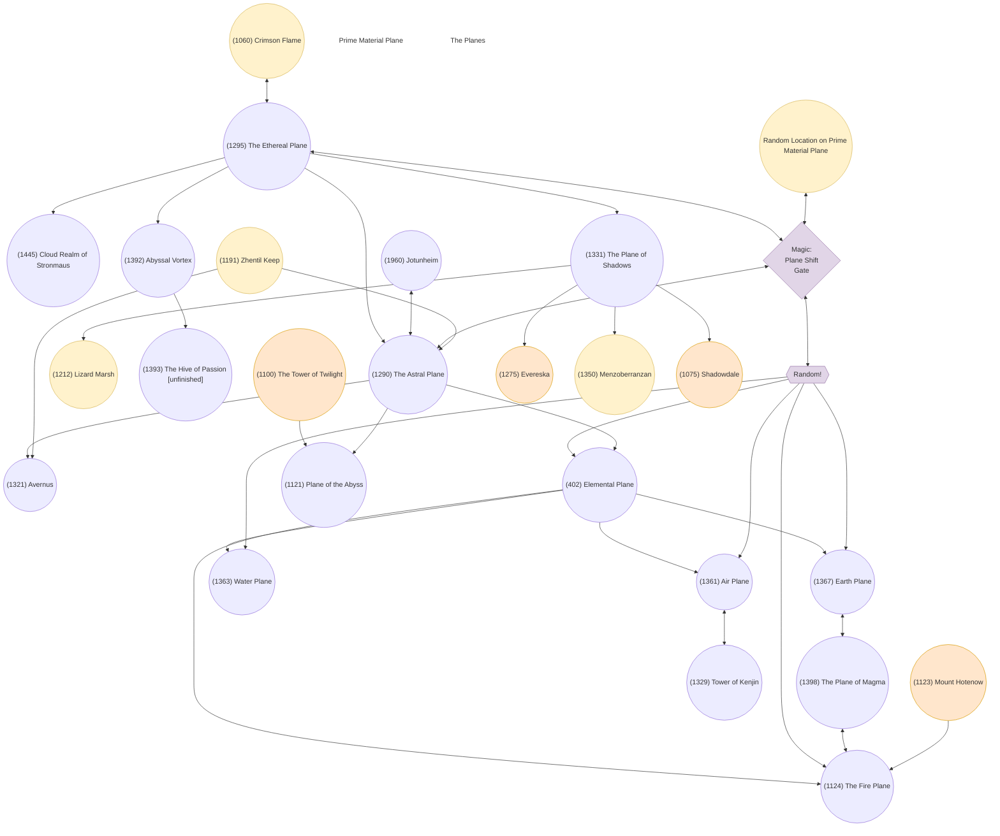

# Planes of Existence

> Text-native extraction of [`../Planes of Existence`](<../Planes of Existence>). The original compressed draw.io file is unchanged.

## Diagram summary

- Page: `Page-1` (`Ihar7eIv9WHPekm20RDQ`)
- Last modified: `2020-04-09T08:19:21.100Z`
- draw.io version: `12.8.8`
- Nodes: **29**
- Connections: **34**
- Source-level unsnapped endpoints: **1**
- Semantically unresolved connections: **0**
- Lossless uncompressed source: [`planes-of-existence.drawio.xml`](planes-of-existence.drawio.xml)

Confirmed semantic correction: connection `4WoLoMWCouOircQyC6YB-24` is **(1290) The Astral Plane → (1321) Avernus**. Its source endpoint is visually inside the Astral Plane but is not snapped to that node in the original draw.io XML.

The Mermaid map below is optimized for topology and search. Exact positions, dimensions, colors, routing points, and original IDs are retained in the node table and uncompressed XML.

## Topology

## Nodes

| Ref | VNUM | Label | Shape | Fill / stroke | Position (x, y) | Size (w × h) | Original draw.io ID |
| --- | ---: | --- | --- | --- | --- | --- | --- |
| n01 | 1060 | (1060) Crimson Flame | ellipse | #fff2cc / #d6b656 | 30, 250 | 80 × 80 | `KyORxnezsSC5rbRuCGsj-1` |
| n02 | 1295 | (1295) The Ethereal Plane | ellipse | default / default | 330, 210 | 80 × 80 | `KyORxnezsSC5rbRuCGsj-3` |
| n03 | 1445 | (1445) Cloud Realm of Stronmaus | ellipse | default / default | 330, 350 | 80 × 80 | `4WoLoMWCouOircQyC6YB-2` |
| n04 | 1290 | (1290) The Astral Plane | ellipse | default / default | 440, 110 | 80 × 80 | `4WoLoMWCouOircQyC6YB-6` |
| n05 |  | Prime Material Plane | annotation | none / none | 0, 465 | 100 × 85 | `4WoLoMWCouOircQyC6YB-8` |
| n06 | 1960 | (1960) Jotunheim | ellipse | default / default | 410, 0 | 80 × 80 | `4WoLoMWCouOircQyC6YB-9` |
| n07 | 1331 | (1331) The Plane of Shadows | ellipse | default / default | 220, 320 | 80 × 80 | `4WoLoMWCouOircQyC6YB-12` |
| n08 | 1212 | (1212) Lizard Marsh | ellipse | #fff2cc / #d6b656 | 160, 450 | 80 × 80 | `4WoLoMWCouOircQyC6YB-14` |
| n09 | 1392 | (1392) Abyssal Vortex | ellipse | default / default | 250, 70 | 80 × 80 | `4WoLoMWCouOircQyC6YB-18` |
| n10 | 1393 | (1393) The Hive of Passion [unfinished] | ellipse | default / default | 120, 80 | 100 × 100 | `4WoLoMWCouOircQyC6YB-22` |
| n11 | 1321 | (1321) Avernus | ellipse | default / default | 510, 10 | 80 × 80 | `4WoLoMWCouOircQyC6YB-23` |
| n12 |  | Magic: Plane Shift Gate | rhombus | #e1d5e7 / #9673a6 | 450, 460 | 80 × 80 | `4WoLoMWCouOircQyC6YB-25` |
| n13 |  | Random Location on Prime Material Plane | ellipse | #fff2cc / #d6b656 | 90, 540 | 150 × 70 | `4WoLoMWCouOircQyC6YB-29` |
| n14 | 402 | (402) Elemental Plane | ellipse | default / default | 620, 120 | 80 × 80 | `4WoLoMWCouOircQyC6YB-31` |
| n15 |  | Random! | triangle | #e1d5e7 / #9673a6 | 700, 450 | 130 × 40 | `4WoLoMWCouOircQyC6YB-34` |
| n16 | 1361 | (1361) Air Plane | ellipse | default / default | 760, 90 | 80 × 80 | `4WoLoMWCouOircQyC6YB-36` |
| n17 | 1363 | (1363) Water Plane | ellipse | default / default | 840, 230 | 80 × 80 | `4WoLoMWCouOircQyC6YB-37` |
| n18 | 1367 | (1367) Earth Plane | ellipse | default / default | 500, 300 | 80 × 80 | `4WoLoMWCouOircQyC6YB-38` |
| n19 | 1124 | (1124) The Fire Plane | ellipse | default / default | 710, 290 | 80 × 80 | `4WoLoMWCouOircQyC6YB-39` |
| n20 | 1398 | (1398) The Plane of Magma | ellipse | default / default | 600, 270 | 80 × 80 | `4WoLoMWCouOircQyC6YB-56` |
| n21 | 1329 | (1329) Tower of Kenjin | ellipse | default / default | 880, 90 | 80 × 80 | `4WoLoMWCouOircQyC6YB-63` |
| n22 |  | The Planes | annotation | none / none | 640, 40 | 140 × 40 | `4WoLoMWCouOircQyC6YB-66` |
| n23 | 1121 | (1121) Plane of the Abyss | ellipse | default / default | 190, 0 | 80 × 80 | `cad3Q23LazA-_Ww1z7og-1` |
| n24 | 1191 | (1191) Zhentil Keep | ellipse | #fff2cc / #d6b656 | 110, 190 | 80 × 80 | `v8rk04_B4NGfk8xuSTiS-1` |
| n25 | 1100 | (1100) The Tower of Twilight | ellipse | #ffe6cc / #d79b00 | 30, 80 | 80 × 80 | `v8rk04_B4NGfk8xuSTiS-4` |
| n26 | 1123 | (1123) Mount Hotenow | ellipse | #ffe6cc / #d79b00 | 330, 435 | 80 × 80 | `v8rk04_B4NGfk8xuSTiS-6` |
| n27 | 1275 | (1275) Evereska | ellipse | #ffe6cc / #d79b00 | 80, 420 | 80 × 80 | `d1yvChcBuvW2Ija3MXj3-2` |
| n28 | 1350 | (1350) Menzoberranzan | ellipse | #fff2cc / #d6b656 | 240, 462.5 | 90 × 90 | `d1yvChcBuvW2Ija3MXj3-5` |
| n29 | 1075 | (1075) Shadowdale | ellipse | #ffe6cc / #d79b00 | 50, 340 | 80 × 80 | `d1yvChcBuvW2Ija3MXj3-7` |

## Connections

| # | Source | Direction | Target | Edge form | Label | Original draw.io ID |
| ---: | --- | --- | --- | --- | --- | --- |
| 1 | Random! | source to target | (402) Elemental Plane | connector |  | `4WoLoMWCouOircQyC6YB-48` |
| 2 | (1295) The Ethereal Plane | source to target | (1445) Cloud Realm of Stronmaus | flex arrow |  | `4WoLoMWCouOircQyC6YB-1` |
| 3 | (1295) The Ethereal Plane | source to target | (1290) The Astral Plane | flex arrow |  | `4WoLoMWCouOircQyC6YB-5` |
| 4 | (1960) Jotunheim | bidirectional | (1290) The Astral Plane | connector |  | `4WoLoMWCouOircQyC6YB-10` |
| 5 | (1295) The Ethereal Plane | source to target | (1331) The Plane of Shadows | flex arrow |  | `4WoLoMWCouOircQyC6YB-11` |
| 6 | (1331) The Plane of Shadows | source to target | (1212) Lizard Marsh | flex arrow |  | `4WoLoMWCouOircQyC6YB-13` |
| 7 | (1060) Crimson Flame | bidirectional | (1295) The Ethereal Plane | flex arrow |  | `4WoLoMWCouOircQyC6YB-16` |
| 8 | (1295) The Ethereal Plane | source to target | (1392) Abyssal Vortex | flex arrow |  | `4WoLoMWCouOircQyC6YB-17` |
| 9 | (1392) Abyssal Vortex | source to target | (1393) The Hive of Passion [unfinished] | flex arrow |  | `4WoLoMWCouOircQyC6YB-21` |
| 10 | (1290) The Astral Plane | source to target | (1321) Avernus | flex arrow; source unsnapped in XML |  | `4WoLoMWCouOircQyC6YB-24` |
| 11 | (1295) The Ethereal Plane | bidirectional | Magic: Plane Shift Gate | flex arrow |  | `4WoLoMWCouOircQyC6YB-26` |
| 12 | Magic: Plane Shift Gate | bidirectional | (1290) The Astral Plane | flex arrow |  | `4WoLoMWCouOircQyC6YB-27` |
| 13 | Random Location on Prime Material Plane | bidirectional | Magic: Plane Shift Gate | flex arrow |  | `4WoLoMWCouOircQyC6YB-30` |
| 14 | (1290) The Astral Plane | source to target | (402) Elemental Plane | flex arrow |  | `4WoLoMWCouOircQyC6YB-33` |
| 15 | (402) Elemental Plane | source to target | (1367) Earth Plane | flex arrow |  | `4WoLoMWCouOircQyC6YB-41` |
| 16 | (402) Elemental Plane | source to target | (1124) The Fire Plane | flex arrow |  | `4WoLoMWCouOircQyC6YB-44` |
| 17 | (402) Elemental Plane | source to target | (1363) Water Plane | flex arrow |  | `4WoLoMWCouOircQyC6YB-45` |
| 18 | (402) Elemental Plane | source to target | (1361) Air Plane | flex arrow |  | `4WoLoMWCouOircQyC6YB-46` |
| 19 | Random! | source to target | (1367) Earth Plane | connector |  | `4WoLoMWCouOircQyC6YB-47` |
| 20 | Random! | source to target | (1124) The Fire Plane | connector |  | `4WoLoMWCouOircQyC6YB-50` |
| 21 | Random! | source to target | (1361) Air Plane | connector |  | `4WoLoMWCouOircQyC6YB-51` |
| 22 | Random! | source to target | (1363) Water Plane | connector |  | `4WoLoMWCouOircQyC6YB-52` |
| 23 | Magic: Plane Shift Gate | bidirectional | Random! | flex arrow |  | `4WoLoMWCouOircQyC6YB-54` |
| 24 | (1367) Earth Plane | bidirectional | (1398) The Plane of Magma | connector |  | `4WoLoMWCouOircQyC6YB-59` |
| 25 | (1398) The Plane of Magma | bidirectional | (1124) The Fire Plane | connector |  | `4WoLoMWCouOircQyC6YB-61` |
| 26 | (1361) Air Plane | bidirectional | (1329) Tower of Kenjin | connector |  | `4WoLoMWCouOircQyC6YB-62` |
| 27 | (1191) Zhentil Keep | source to target | (1290) The Astral Plane | flex arrow |  | `v8rk04_B4NGfk8xuSTiS-3` |
| 28 | (1100) The Tower of Twilight | source to target | (1121) Plane of the Abyss | flex arrow |  | `v8rk04_B4NGfk8xuSTiS-5` |
| 29 | (1123) Mount Hotenow | source to target | (1124) The Fire Plane | flex arrow |  | `v8rk04_B4NGfk8xuSTiS-7` |
| 30 | (1191) Zhentil Keep | source to target | (1321) Avernus | flex arrow |  | `d1yvChcBuvW2Ija3MXj3-1` |
| 31 | (1331) The Plane of Shadows | source to target | (1275) Evereska | flex arrow |  | `d1yvChcBuvW2Ija3MXj3-3` |
| 32 | (1331) The Plane of Shadows | source to target | (1350) Menzoberranzan | flex arrow |  | `d1yvChcBuvW2Ija3MXj3-4` |
| 33 | (1331) The Plane of Shadows | source to target | (1075) Shadowdale | flex arrow |  | `d1yvChcBuvW2Ija3MXj3-8` |
| 34 | (1290) The Astral Plane | source to target | (1121) Plane of the Abyss | flex arrow |  | `d1yvChcBuvW2Ija3MXj3-9` |

## Interpretation notes

- Direction is derived only from explicit draw.io `startArrow` and `endArrow` settings.
- Connection 10's source is assigned to the Astral Plane from the author's confirmation; the lossless XML retains its original loose endpoint.
- “Unmarked connector” means neither endpoint has an explicit arrowhead in the stored edge style; no direction is inferred.
- Colors and shapes are preserved as visual metadata, not assigned semantic meaning unless the source labels state one.
- The Mermaid rendering may rearrange nodes; consult the position columns or uncompressed XML for the authored layout.
