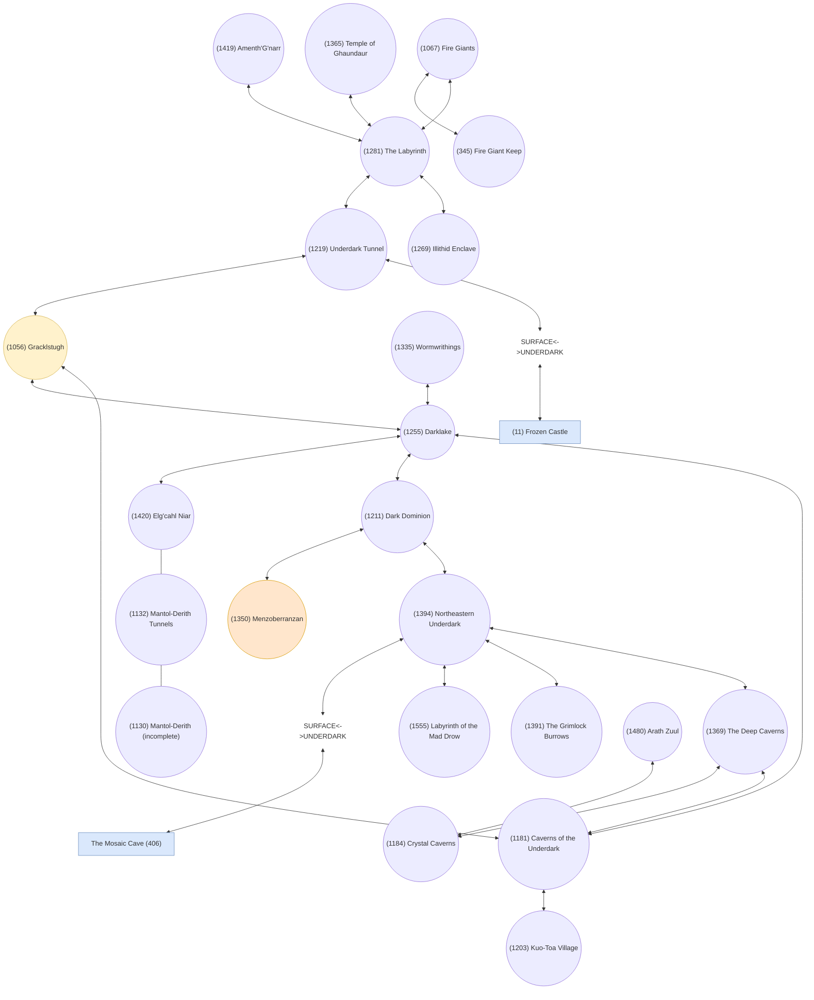

# Underdark (Underworld)

> Text-native extraction of [`../Underdark (Underworld)`](<../Underdark (Underworld)>). The original compressed draw.io file is unchanged.

## Diagram summary

- Page: `Page-1` (`ekaBI4SBrVYvSDzULtQy`)
- Last modified: `2022-11-21T10:51:52.876Z`
- draw.io version: `20.5.3`
- Nodes: **27**
- Connections: **28**
- Connections with an unconnected endpoint: **0**
- Lossless uncompressed source: [`underdark-underworld.drawio.xml`](underdark-underworld.drawio.xml)

The Mermaid map below is optimized for topology and search. Exact positions, dimensions, colors, routing points, and original IDs are retained in the node table and uncompressed XML.

## Topology

## Nodes

| Ref | VNUM | Label | Shape | Fill / stroke | Position (x, y) | Size (w × h) | Original draw.io ID |
| --- | ---: | --- | --- | --- | --- | --- | --- |
| n01 | 11 | (11) Frozen Castle | process | #dae8fc / #6c8ebf | 350, 480 | 120 × 60 | `WbeIyBOG-1IH5Gfox8lr-1` |
| n02 | 1219 | (1219) Underdark Tunnel | ellipse | default / default | 560, 680 | 80 × 80 | `WbeIyBOG-1IH5Gfox8lr-8` |
| n03 | 1056 | (1056) Gracklstugh | ellipse | #fff2cc / #d6b656 | 660, 595 | 100 × 100 | `WbeIyBOG-1IH5Gfox8lr-9` |
| n04 | 1281 | (1281) The Labyrinth | ellipse | default / default | 480, 760 | 80 × 80 | `WbeIyBOG-1IH5Gfox8lr-11` |
| n05 | 1181 | (1181) Caverns of the Underdark | ellipse | default / default | 810, 595 | 100 × 100 | `WbeIyBOG-1IH5Gfox8lr-14` |
| n06 | 1369 | (1369) The Deep Caverns | ellipse | default / default | 1060, 590 | 90 × 90 | `WbeIyBOG-1IH5Gfox8lr-28` |
| n07 | 1269 | (1269) Illithid Enclave | ellipse | default / default | 400, 680 | 80 × 80 | `WbeIyBOG-1IH5Gfox8lr-22` |
| n08 | 1067 | (1067) Fire Giants | ellipse | default / default | 560, 840 | 80 × 80 | `WbeIyBOG-1IH5Gfox8lr-24` |
| n09 | 1365 | (1365) Temple of Ghaundaur | ellipse | default / default | 390, 830 | 90 × 90 | `WbeIyBOG-1IH5Gfox8lr-26` |
| n10 | 1255 | (1255) Darklake | ellipse | default / default | 740, 490 | 80 × 80 | `WbeIyBOG-1IH5Gfox8lr-33` |
| n11 | 1203 | (1203) Kuo-Toa Village | ellipse | default / default | 780, 740 | 80 × 80 | `WbeIyBOG-1IH5Gfox8lr-35` |
| n12 | 1394 | (1394) Northeastern Underdark | ellipse | default / default | 1040, 350 | 80 × 80 | `WbeIyBOG-1IH5Gfox8lr-40` |
| n13 | 1211 | (1211) Dark Dominion | ellipse | default / default | 860, 470 | 80 × 80 | `niEgfpVS8LF_mnxiFOAZ-1` |
| n14 | 1391 | (1391) The Grimlock Burrows | ellipse | default / default | 930, 330 | 80 × 80 | `niEgfpVS8LF_mnxiFOAZ-3` |
| n15 | 1555 | (1555) Labyrinth of the Mad Drow | ellipse | default / default | 1160, 390 | 100 × 100 | `niEgfpVS8LF_mnxiFOAZ-5` |
| n16 | 1350 | (1350) Menzoberranzan | ellipse | #ffe6cc / #d79b00 | 970, 510 | 100 × 100 | `niEgfpVS8LF_mnxiFOAZ-11` |
| n17 | 1335 | (1335) Wormwrithings | ellipse | default / default | 610, 485 | 90 × 90 | `niEgfpVS8LF_mnxiFOAZ-13` |
| n18 | 1420 | (1420) Elg'cahl Niar | ellipse | default / default | 790, 370 | 80 × 80 | `niEgfpVS8LF_mnxiFOAZ-18` |
| n19 |  | SURFACE<->UNDERDARK | annotation | none / none | 330, 595 | 320 × 40 | `niEgfpVS8LF_mnxiFOAZ-20` |
| n20 | 406 | The Mosaic Cave (406) | process | #dae8fc / #6c8ebf | 1035, 190 | 120 × 60 | `5kWEsVlv7hL-EvVSmZYw-1` |
| n21 |  | SURFACE<->UNDERDARK | annotation | none / none | 970, 270 | 320 × 40 | `5kWEsVlv7hL-EvVSmZYw-4` |
| n22 | 1132 | (1132) Mantol-Derith Tunnels | ellipse | default / default | 660, 360 | 100 × 100 | `ZFpOi0JFf9t6VFgwT7bt-1` |
| n23 | 1130 | (1130) Mantol-Derith (incomplete) | ellipse | default / default | 520, 360 | 100 × 100 | `ZFpOi0JFf9t6VFgwT7bt-3` |
| n24 | 345 | (345) Fire Giant Keep | ellipse | default / default | 660, 760 | 80 × 80 | `eMH9Ad4OW332Oy4qWF67-1` |
| n25 | 1419 | (1419) Amenth'G'narr | ellipse | default / default | 480, 930 | 90 × 90 | `eMH9Ad4OW332Oy4qWF67-3` |
| n26 | 1184 | (1184) Crystal Caverns | ellipse | default / default | 930, 670 | 90 × 90 | `eMH9Ad4OW332Oy4qWF67-5` |
| n27 | 1480 | (1480) Arath Zuul | ellipse | default / default | 1070, 710 | 90 × 90 | `eMH9Ad4OW332Oy4qWF67-7` |

## Connections

| # | Source | Direction | Target | Edge form | Label | Original draw.io ID |
| ---: | --- | --- | --- | --- | --- | --- |
| 1 | (1219) Underdark Tunnel | bidirectional | SURFACE<->UNDERDARK | connector |  | `WbeIyBOG-1IH5Gfox8lr-19` |
| 2 | (1281) The Labyrinth | bidirectional | (1269) Illithid Enclave | connector |  | `WbeIyBOG-1IH5Gfox8lr-23` |
| 3 | (1067) Fire Giants | bidirectional | (1281) The Labyrinth | connector |  | `WbeIyBOG-1IH5Gfox8lr-25` |
| 4 | (1369) The Deep Caverns | bidirectional | (1181) Caverns of the Underdark | connector |  | `WbeIyBOG-1IH5Gfox8lr-31` |
| 5 | (1056) Gracklstugh | bidirectional | (1181) Caverns of the Underdark | connector |  | `WbeIyBOG-1IH5Gfox8lr-32` |
| 6 | (1255) Darklake | bidirectional | (1181) Caverns of the Underdark | connector |  | `WbeIyBOG-1IH5Gfox8lr-37` |
| 7 | (1181) Caverns of the Underdark | bidirectional | (1203) Kuo-Toa Village | connector |  | `WbeIyBOG-1IH5Gfox8lr-38` |
| 8 | (1056) Gracklstugh | bidirectional | (1255) Darklake | connector |  | `WbeIyBOG-1IH5Gfox8lr-39` |
| 9 | (1394) Northeastern Underdark | bidirectional | (1369) The Deep Caverns | connector |  | `WbeIyBOG-1IH5Gfox8lr-41` |
| 10 | (1281) The Labyrinth | bidirectional | (1219) Underdark Tunnel | connector |  | `WbeIyBOG-1IH5Gfox8lr-42` |
| 11 | (1365) Temple of Ghaundaur | bidirectional | (1281) The Labyrinth | connector |  | `WbeIyBOG-1IH5Gfox8lr-45` |
| 12 | (1219) Underdark Tunnel | bidirectional | (1056) Gracklstugh | connector |  | `WbeIyBOG-1IH5Gfox8lr-47` |
| 13 | (1211) Dark Dominion | bidirectional | (1394) Northeastern Underdark | connector |  | `niEgfpVS8LF_mnxiFOAZ-2` |
| 14 | (1394) Northeastern Underdark | bidirectional | (1391) The Grimlock Burrows | connector |  | `niEgfpVS8LF_mnxiFOAZ-4` |
| 15 | (1394) Northeastern Underdark | bidirectional | (1555) Labyrinth of the Mad Drow | connector |  | `niEgfpVS8LF_mnxiFOAZ-6` |
| 16 | (1255) Darklake | bidirectional | (1211) Dark Dominion | connector |  | `niEgfpVS8LF_mnxiFOAZ-8` |
| 17 | (1211) Dark Dominion | bidirectional | (1350) Menzoberranzan | connector |  | `niEgfpVS8LF_mnxiFOAZ-12` |
| 18 | (1335) Wormwrithings | bidirectional | (1255) Darklake | connector |  | `niEgfpVS8LF_mnxiFOAZ-17` |
| 19 | (1420) Elg'cahl Niar | unmarked connector | (1132) Mantol-Derith Tunnels | orthogonal connector |  | `ZFpOi0JFf9t6VFgwT7bt-2` |
| 20 | (1255) Darklake | bidirectional | (1420) Elg'cahl Niar | connector |  | `niEgfpVS8LF_mnxiFOAZ-19` |
| 21 | SURFACE<->UNDERDARK | bidirectional | (11) Frozen Castle | connector |  | `niEgfpVS8LF_mnxiFOAZ-22` |
| 22 | SURFACE<->UNDERDARK | bidirectional | The Mosaic Cave (406) | connector |  | `5kWEsVlv7hL-EvVSmZYw-2` |
| 23 | (1394) Northeastern Underdark | bidirectional | SURFACE<->UNDERDARK | connector |  | `5kWEsVlv7hL-EvVSmZYw-3` |
| 24 | (1132) Mantol-Derith Tunnels | unmarked connector | (1130) Mantol-Derith (incomplete) | orthogonal connector |  | `ZFpOi0JFf9t6VFgwT7bt-4` |
| 25 | (1067) Fire Giants | bidirectional | (345) Fire Giant Keep | connector |  | `eMH9Ad4OW332Oy4qWF67-2` |
| 26 | (1419) Amenth'G'narr | bidirectional | (1281) The Labyrinth | connector |  | `eMH9Ad4OW332Oy4qWF67-4` |
| 27 | (1369) The Deep Caverns | bidirectional | (1184) Crystal Caverns | connector |  | `eMH9Ad4OW332Oy4qWF67-6` |
| 28 | (1480) Arath Zuul | bidirectional | (1184) Crystal Caverns | connector |  | `eMH9Ad4OW332Oy4qWF67-8` |

## Interpretation notes

- Direction is derived only from explicit draw.io `startArrow` and `endArrow` settings.
- “Unmarked connector” means neither endpoint has an explicit arrowhead in the stored edge style; no direction is inferred.
- Colors and shapes are preserved as visual metadata, not assigned semantic meaning unless the source labels state one.
- The Mermaid rendering may rearrange nodes; consult the position columns or uncompressed XML for the authored layout.
